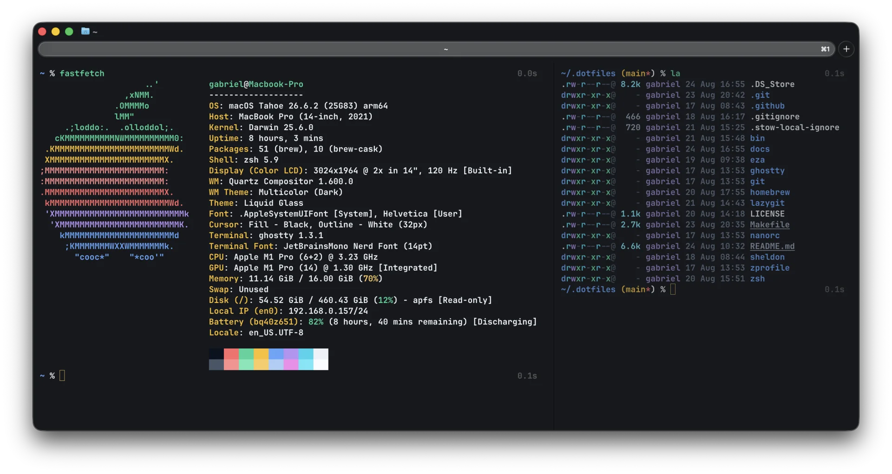

<!-- markdownlint-disable MD033 -->
<!-- markdownlint-disable MD041 -->
<div align="center">

  <!-- Badges status -->
  [](https://github.com/geogabrielp/dotfiles/actions)
  [](https://github.com/geogabrielp/dotfiles/blob/main/LICENSE)
  
  

  <!-- Wide banner -->
  

  <br>

</div>

My **personal dotfiles**, managed with **GNU Stow + Git**: clean, fast and
versioned, with the same setup on **macOS** and **Ubuntu/WSL**. I decided to share publicly as a reference.

> [!IMPORTANT]
> **Use at your own risk.** These are *my personal configurations*, tailored
> to *my* workflow and machines. Review every file before applying anything.
> Your machine, your responsibility.

---

## 📸 Preview



---

## 🤔 Why Git + Stow?

Your shell config is the longest-lived project you'll ever own. **Git** gives you
backup, history and rollback. **Stow** gives you one symlink per tool, with the
files still living in this repo.

```bash
~/.zshrc → ~/.dotfiles/zsh/.zshrc    # stow zsh
```

**Why not the alternatives:** this is the cleanest, simplest and most portable
solution I found; tools like [chezmoi](https://www.chezmoi.io/) or
[yadm](https://yadm.io/) are overkill for my needs. Stow is battle-tested and
does one thing well: **symlink dotfiles**.

---

## 🧰 Prerequisites

| Requirement | macOS | Ubuntu / WSL |
| --- | --- | --- |
| **Xcode Command Line Tools** | `xcode-select --install` | not needed |
| **Homebrew** / Linuxbrew | [brew.sh](https://brew.sh) | [Homebrew on Linux](https://docs.brew.sh/Homebrew-on-Linux) |
| `git`, `make` | included with the CLT | `apt install -y git make` |
| `zsh` | bundled | `apt install -y zsh` |
| **GNU Stow** | `brew install stow` | `apt install -y stow` |

> [!NOTE]
> [`bin/bootstrap.sh`](bin/bootstrap.sh) below installs every dependency **except
> the CLT**: when it is missing the script opens the dialog and stops, so you
> finish the install and run it again.

---

## 🚀 Install

```bash
curl -fsSL https://raw.githubusercontent.com/geogabrielp/dotfiles/main/bin/bootstrap.sh | bash
```

Idempotent, safe to re-run. On Ubuntu/WSL it first installs
`build-essential procps file curl git zsh stow unzip bsdextrautils` via apt. Then it installs
Homebrew (also on Linux, so the same Brewfile works), clones the repo, runs
`brew bundle` (which also brings the CLI tools), links every package and creates
the `*_local` overrides.

> [!WARNING]
> Piping to `bash` runs the script as-is in your shell, so I recommend reading
> [`bin/bootstrap.sh`](bin/bootstrap.sh) first and understanding what it does.

### 💪 Doing it by hand

```bash
# 1. dependencies
#    macOS:       xcode-select --install  +  Homebrew
#    Ubuntu/WSL:  sudo apt install -y build-essential procps file curl git zsh stow unzip bsdextrautils
#                 + Linuxbrew (https://docs.brew.sh/Homebrew-on-Linux)

# 2. clone
git clone https://github.com/geogabrielp/dotfiles.git ~/.dotfiles
cd ~/.dotfiles

# 3. CLI tools (installs stow + everything else via Homebrew/Linuxbrew)
brew bundle --file homebrew/Formulae.brewfile

# 4. link the dotfiles (needs stow from step 1 or 3)
make install

# 5. optional, macOS only: GUI apps
brew bundle --file homebrew/Casks.brewfile
```

### ✅ Verify

```bash
ls -la ~/.zshrc ~/.gitconfig
# lrwxr-xr-x ... ~/.zshrc -> ~/.dotfiles/zsh/.zshrc
```

If you already have configs in place see `make adopt`: pulls them into the repo (it
overwrites repo files, so check `git status` right after).

---

## 📦 What's included

| Package | Links into `$HOME` | Purpose |
| --- | --- | --- |
| `zsh/` | `~/.zshrc`, `~/.zshrc.d/` | env, options, plugins, prompt, aliases, functions |
| `zprofile/` | `~/.zprofile` | login env (Homebrew) |
| `git/` | `~/.gitconfig`, `~/.gitignore_global` | config, aliases, HTTPS via `gh` |
| `sheldon/` | `~/.config/sheldon/` | zsh plugins: autosuggestions, completions, highlighting |
| `homebrew/` | `~/Formulae.brewfile`, `~/Casks.brewfile` | CLI tools (required) + GUI apps (optional) |
| `ghostty/` | `~/.config/ghostty/` | terminal config + theme |
| `eza/` | `~/.config/eza/` | `ls` replacement theme |
| `lazygit/` | `~/.config/lazygit/` | git TUI config |
| `nanorc/` | `~/.nanorc` | nano config + syntax highlighting |
| [`macos/`](macos/bin/set-defaults.sh) | not stowed | my macOS defaults (Finder, Dock, trackpad, screenshots): `make macos`, no-op on Linux |

New packages are detected automatically: any top-level folder is stowed unless
it is one of `$(INFRA)` in the [Makefile](Makefile) (`bin`, `docs`, `macos`,
`.github`). See `make help` for a list of all targets.

## 🧩 Overrides

Machine-specific bits go in `~/.zshrc_local`, `~/.zprofile_local` and
`~/.gitconfig_local` (created by the bootstrap, git-ignored).

## 🧪 CI / pre-commit

Every check is a Makefile target, so CI and your machine run the same thing:

- `make lint` - shellcheck + `zsh -n`
- `make check-home` - stows every package into a throwaway HOME
- `make check-brewfile` - every formula/cask still resolves (weekly, in CI)

`pre-commit install` is once per clone and adds `gitleaks` + `make lint` before
each commit.

---

## ⚖️ License

[MIT](LICENSE) - fork it, adapt it, or just steal the ideas.

---

<div align="center">

🛠️ Built with **GNU Stow + Git**, inspired by [How I manage my dotfiles using GNU Stow](https://tamerlan.dev/how-i-manage-my-dotfiles-using-gnu-stow/).
<br>
*"you are your dotfiles"*
</div>
